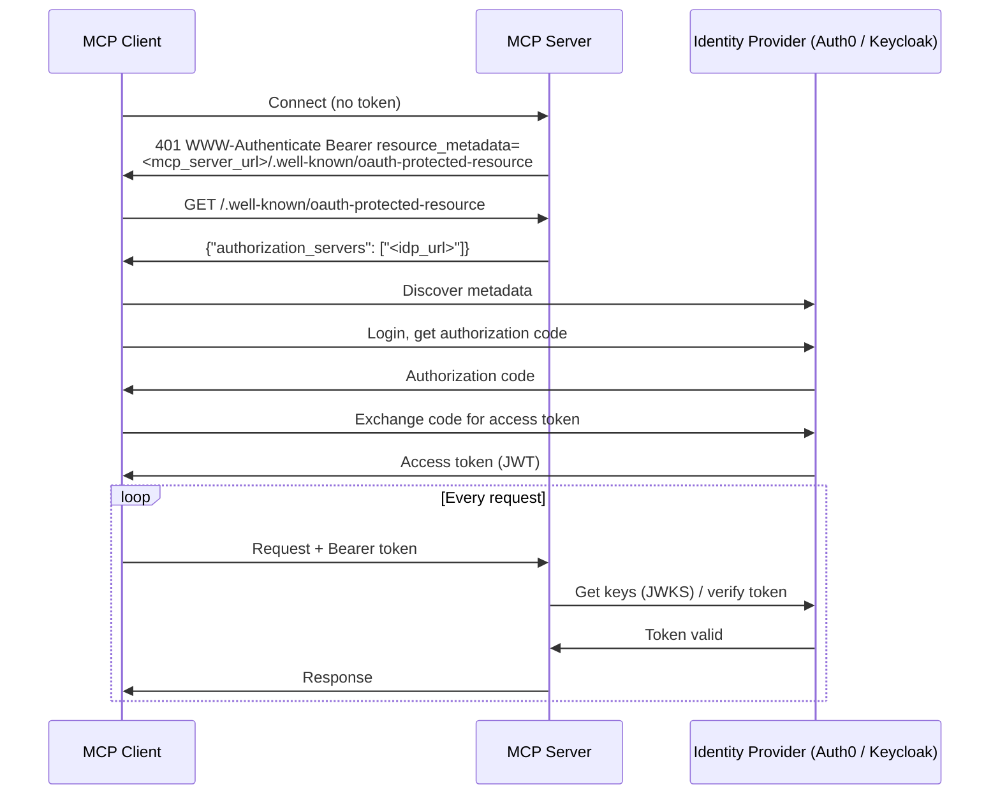

# Configuring Authentication

The Actian MCP Server for Actian NoSQL supports OAuth 2.0 and OpenID Connect (OIDC) authentication. When this feature is enabled, every client request must include a valid JSON Web Token (JWT) issued by a trusted identity provider (IdP).

!!! info "Database credentials vs. OAuth:"
    There are two distinct types of authentication used by the system:

     - **Database credentials:** The `user:password` portion of the NoSQL connection URL (for example, `cars@db.example.com#<USER>:<PASSWORD>`) authenticates with the database itself whenever the server opens a connection to it, not only when the server starts.
     - **OAuth 2.0:** This protocol controls access to the MCP Server endpoint.

## Working with OAuth

Authentication is disabled by default. When enabled, all `/mcp/*` endpoints require a valid Bearer token issued by an OIDC provider. The server acts as an OAuth 2.0 resource server and exposes a resource metadata endpoint at `/.well-known/oauth-protected-resource`. MCP clients use this endpoint to discover the identity provider and initiate the appropriate OAuth flow.

The server supports two primary flows:

- **Authorization Code:** Used for interactive clients (such as Claude Desktop, Cursor, and the FastMCP Python client). The client redirects the user to the IdP for login and receives a token after consent.
- **Client Credentials:** Used for machine-to-machine (M2M) scenarios where no user interaction is possible. The client authenticates directly with the IdP using its own credentials.

The diagram below illustrates the Authorization Code flow:



### Configuration

| Property | Required | Description |
|---|---|---|
| `mcp.auth.enabled` | Yes (to enable) | Set to `true` to enable OAuth2 authentication. Disabled by default. |
| `quarkus.oidc.auth-server-url` | Yes (if enabled) | Issuer URL of your OIDC provider, for example, `https://your-idp.example.com/`. |
| `quarkus.oidc.sse-tenant.auth-server-url` | No | Overrides the OIDC provider for the SSE endpoint (`/mcp/sse`) only. Defaults to `quarkus.oidc.auth-server-url`. |
| `quarkus.oidc.token.audience` | Yes (if enabled) | The audience the server accepts in the `aud` claim of a token. Takes a comma-separated list. The server does not start without it. See [Token Audience](#token-audience). |
| `quarkus.oidc.sse-tenant.token.audience` | No | Defaults to `quarkus.oidc.token.audience`. Set it only when you override the SSE provider. An empty value or `any` stops the server at startup. |
| `quarkus.oidc.resource-metadata.scopes` | Depends on the provider | The scopes the server publishes as `scopes_supported` in its resource metadata, comma-separated. MCP clients read this list and request exactly those scopes. A Keycloak deployment should always set it; an Auth0 deployment needs it only in write mode. See [Advertising scopes to MCP clients](scopes.md#advertising-scopes-to-mcp-clients). |

!!! note "Quarkus OIDC configuration"
    The table lists the most common properties. The full set of options is available in the [Quarkus OIDC configuration reference](https://quarkus.io/guides/security-openid-connect-client-reference#configuration-reference).


Two OIDC tenants are preconfigured:

| Tenant | Path | Property Prefix |
|---|---|---|
| Default | `/mcp/*` | `quarkus.oidc.*` |
| SSE | `/mcp/sse` | `quarkus.oidc.sse-tenant.*` |

Both tenants share the same authentication server URL by default. Override the SSE tenant only if that endpoint requires a different identity provider. The SSE tenant also takes its audience from `quarkus.oidc.token.audience`, so you set one property unless you override the SSE provider.

### Token Audience

The audience (`aud` claim) says which service a token is for. With authentication on, the server accepts a token only when its `aud` claim contains a value set in `quarkus.oidc.token.audience`:

- The property takes a comma-separated list of audiences.
- Matching is exact, so a trailing `/` matters.
- A token without an `aud` claim is rejected.
- The `aud` claim may be a string or an array. One matching value is enough.
- The value `any` is refused, because Quarkus treats it as "skip the check".
- The SSE tenant inherits the value.

What to set depends on your provider:

- **Auth0:** The API Identifier, character for character. See [Step 3: Create an Auth0 API](auth0/index.md#step-3-create-an-auth0-api).
- **Keycloak:** The Included Custom Audience value of the Audience mapper, for example `nsql-mcp`. See [Step 3: Add the Token Audience](keycloak/index.md#step-3-add-the-token-audience).

With authentication on and no audience set, the server exits at startup with an error that names `quarkus.oidc.token.audience`.

### Calling Applications

An application that has already signed the user in, for example an agent application, can call this server for that user. It needs a token for the same user whose `aud` claim contains this server's audience:

- **Keycloak:** The application exchanges the user's token with standard token exchange (RFC 8693). See [Token Exchange for a Calling Application](keycloak/index.md#token-exchange-for-a-calling-application).
- **Auth0:** The application requests this server's audience when the user signs in. See [Calling Applications](auth0/index.md#calling-applications).

The server accepts any token that carries its audience and cannot tell how the token was obtained, so keep this server's audience off the application's own login tokens. The application requests its own scopes, so `quarkus.oidc.resource-metadata.scopes` does not apply to it.

### Scopes

What a token may do is decided by its scopes: `mcp:write` without targets, and the scopes of each target with targets. Which scopes grant what, the claims they are read from, what a caller gets when one is missing, and how MCP clients learn which scopes to request are described in [Scopes](scopes.md).

### Caller Identity

The server takes the caller's name from the token's principal (the `upn` claim, then `preferred_username`, then `sub`) for its logs and to tie a pending write confirmation to the user. A token without a user name claim is not rejected.

The server does not impersonate users. Every database statement runs as the user in the connection URL of the database the call reaches: `nsql.connectionURL` without targets, and the connection URL of the target with targets. What a caller may do is decided by the token's audience and by scopes: the `mcp:write` scope without targets, and the scopes of each target with targets (see [Scopes per Target](scopes.md#scopes-per-target)). See [What each call must clear](../write-support.md#what-each-call-must-clear).

### Example

Add the following to your `application.properties` and start the server as instructed in [Start the Server](../index.md#start-the-server):

```properties
nsql.connectionURL=<connection-url>
mcp.auth.enabled=true
quarkus.oidc.auth-server-url=https://your-idp.example.com/
quarkus.oidc.token.audience=<your-audience>
```

### Trusting a Self-Signed or Internal-CA Identity Provider Certificate

The server calls your IdP over HTTPS to read its discovery document and signing keys. It trusts certificates issued by public certificate authorities, so this applies only when the IdP certificate is self-signed or issued by an internal certificate authority. Give the server the IdP's CA certificate in a named TLS configuration and point both OIDC tenants at it:

```properties
quarkus.tls.idp.trust-store.pem.certs=/certs/idp-ca.crt
quarkus.oidc.tls.tls-configuration-name=idp
quarkus.oidc.sse-tenant.tls.tls-configuration-name=idp
```

Put the CA file in the certificate directory you mount into the container, as in the `-v $(pwd)/certs:/certs:ro` line of the example in [Secure Remote Deployments with HTTPS and TLS](#secure-remote-deployments-with-https-and-tls). This is separate from the certificate the server presents to MCP clients, which that section describes.

## Secure Remote Deployments with HTTPS and TLS

To secure the connection, you must provide a certificate and a private key. In the property names below, the `.0.` represents the index of the PEM keystore entry; increment this index to add multiple certificates.

| Property | Required | Description |
|---|---|---|
| `quarkus.tls.key-store.pem.0.cert` | Yes (for TLS) | Path to the PEM certificate file inside the container. |
| `quarkus.tls.key-store.pem.0.key` | Yes (for TLS) | Path to the PEM private key file inside the container. |
| `quarkus.http.insecure-requests` | No | Controls how insecure HTTP requests are handled. Defaults to `enabled`, which keeps the plain HTTP port open alongside HTTPS; configuring a certificate alone does not close it. Set it to `redirect` to send all HTTP traffic to HTTPS, or to `disabled` to reject insecure HTTP requests entirely. |

!!! warning "Setting `quarkus.http.insecure-requests` to `redirect` or `disabled` requires TLS"
    Both values need a certificate and key in place — the two `quarkus.tls.key-store.pem.0.*` properties above. Without them the server refuses to start.

!!! note "Quarkus TLS configuration"
    The table lists the most common properties. The full set of options is provided by the [Quarkus TLS Registry](https://quarkus.io/guides/tls-registry-reference) extension.

### Example

!!! note "Generating and trusting a self-signed certificate"
    For instructions on generating a self-signed certificate and trusting it in the MCP client, see [Secure Remote Deployments with HTTPS and TLS](../../ingres/authentication/index.md#secure-remote-deployments-with-https-and-tls) in the main Authentication guide.

1. Add the following to your `application.properties`:

```properties
nsql.connectionURL=<connection-url>
quarkus.tls.key-store.pem.0.cert=/certs/server.crt
quarkus.tls.key-store.pem.0.key=/certs/server.key
quarkus.http.insecure-requests=redirect
```
2. Mount both the properties file and the certificate directory, and expose the HTTPS port:

```bash
docker run \
  -v $(pwd)/application.properties:/home/jboss/config/application.properties:ro \
  -v $(pwd)/certs:/certs:ro \
  -p 8080:8080 \
  -p 8443:8443 \
  actian/nsql-mcp-server:1.2.0
```

## Next Steps

<div class="grid cards" markdown>

- :material-shield-key: **[Scopes](scopes.md)**  
  The scopes that decide what a caller may do, with targets and without, and what a caller gets when one is missing.

- :material-account-key: **[Identity Providers](identity-providers/index.md)**  
  Step-by-step setup for Auth0 or Keycloak.

</div>
