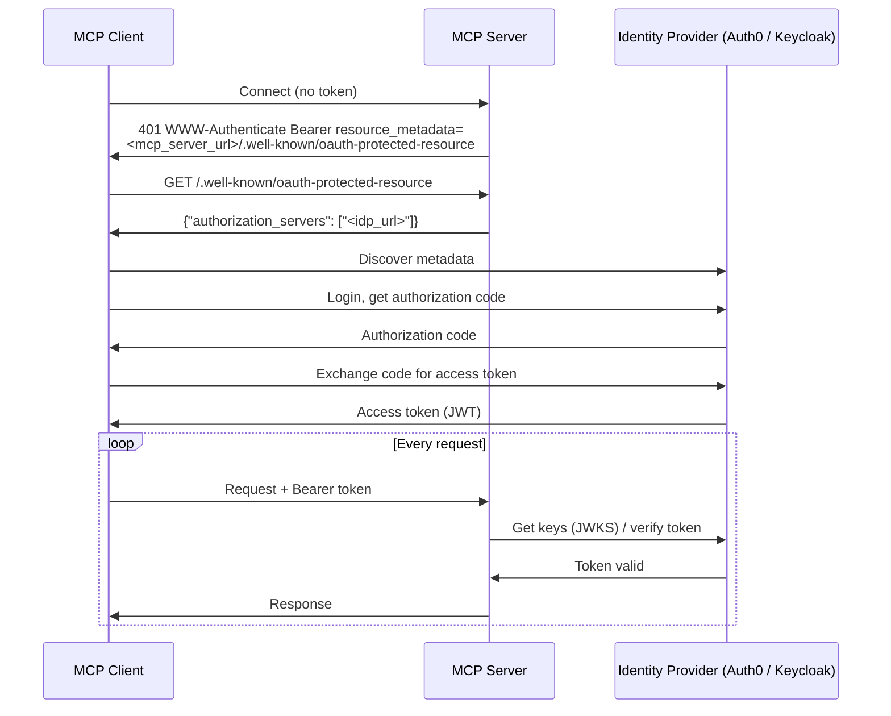

# Configuring Authentication

The Actian MCP Server for Actian NoSQL supports OAuth 2.0 and OpenID Connect (OIDC) authentication. When this feature is enabled, every client request must include a valid JSON Web Token (JWT) issued by a trusted identity provider (IdP).

!!! info "Database credentials vs. OAuth:"
    There are two distinct types of authentication used by the system:

     - **Database credentials:** The `user:password` portion of the NoSQL connection URL (for example, `cars@localhost#admin:secret`) is used to authenticate with the database itself when the server starts.
     - **OAuth 2.0:** This protocol controls access to the MCP Server endpoint.

!!! warning "Upgrading to 1.2: the token audience is now required"
    With `mcp.auth.enabled=true`, version 1.2 refuses to start unless `quarkus.oidc.token.audience` is set, and it rejects every token whose `aud` claim does not contain that value (HTTP 401). Under Kubernetes, the missing setting shows as a crash loop. To fix an existing deployment:

    - **Auth0:** Set `quarkus.oidc.token.audience` to the API Identifier. See [Step 3: Create an Auth0 API](auth0/index.md#step-3-create-an-auth0-api).
    - **Keycloak:** Add an audience client scope with an Audience mapper to your clients, and set `quarkus.oidc.token.audience` to its value. See [Step 2.1: Add the Token Audience](keycloak/index.md#step-21-add-the-token-audience).

    For the full rules, see [Token Audience](#token-audience).

## Working with OAuth

Authentication is disabled by default. When enabled, all `/mcp/*` endpoints require a valid Bearer token issued by an OIDC provider. The server acts as an OAuth 2.0 resource server and exposes a resource metadata endpoint at `/.well-known/oauth-protected-resource`. MCP clients use this endpoint to discover the identity provider and initiate the appropriate OAuth flow.

The server supports three primary flows:

- **Authorization Code:** Used for interactive clients (such as Claude Desktop, Cursor, and the FastMCP Python client). The client redirects the user to the IdP for login and receives a token after consent.
- **Client Credentials:** Used for machine-to-machine (M2M) scenarios where no user interaction is possible. The client authenticates directly with the IdP using its own credentials.
- **Token Exchange:** Used by an application that has already signed the user in (for example, Actian Agentic). The application exchanges that user's token at the IdP for one whose audience is this server, using OAuth 2.0 Token Exchange (RFC 8693). See [Token Exchange for Calling Applications](#token-exchange-for-calling-applications).

| Flow | At the keyboard | Token represents | Who calls the IdP |
|---|---|---|---|
| Authorization Code | The user, in a browser | The user | The MCP client after the login redirect |
| Client Credentials | Nobody | The application | The application with its client ID and secret |
| Token Exchange (RFC 8693) | Nobody | The user, acting through the application | The application, presenting the user's existing token |

The diagram below illustrates the Authorization Code flow:



### Configuration

| Property | Required | Description |
|---|---|---|
| `mcp.auth.enabled` | Yes (to enable) | Set to `true` to enable OAuth2 authentication. Disabled by default. |
| `quarkus.oidc.auth-server-url` | Yes (if enabled) | Issuer URL of your OIDC provider, for example, `https://your-idp.example.com/`. |
| `quarkus.oidc.sse-tenant.auth-server-url` | No | Overrides the OIDC provider for the SSE endpoint (`/mcp/sse`) only. Defaults to `quarkus.oidc.auth-server-url`. |
| `quarkus.oidc.token.audience` | Yes (if enabled) | The audience the server accepts in the `aud` claim of a token. Takes a comma-separated list. The server does not start without it. See [Token Audience](#token-audience). |
| `quarkus.oidc.sse-tenant.token.audience` | No | Defaults to `quarkus.oidc.token.audience`. Set it only when you override the SSE provider. An empty value or `any` stops the server at startup. |
| `quarkus.oidc.resource-metadata.scopes` | Depends on the provider | The scopes the server publishes as `scopes_supported` in its resource metadata, comma-separated. MCP clients read this list and request exactly those scopes. A Keycloak deployment should always set it; an Auth0 deployment needs it only in write mode. See [Advertising scopes to MCP clients](#advertising-scopes-to-mcp-clients). |

!!! note "Quarkus OIDC configuration"
    The table lists the most common properties. The full set of options is available in the [Quarkus OIDC configuration reference](https://quarkus.io/guides/security-openid-connect-client-reference#configuration-reference).


Two OIDC tenants are preconfigured:

| Tenant | Path | Property Prefix |
|---|---|---|
| Default | `/mcp/*` | `quarkus.oidc.*` |
| SSE | `/mcp/sse` | `quarkus.oidc.sse-tenant.*` |

Both tenants share the same authentication server URL by default. Override the SSE tenant only if that endpoint requires a different identity provider. The SSE tenant also takes its audience from `quarkus.oidc.token.audience`, so you set one property unless you override the SSE provider.

### Token Audience

The audience (`aud` claim) says which service a token is for. With authentication on, the server accepts a token only when its `aud` claim contains the value you set in `quarkus.oidc.token.audience`. Audience and scopes answer different questions:

| | Audience (`aud`) | Scopes (`scope`) |
|---|---|---|
| Question | Which service is this token for? | What may the holder do there? |
| Checked by | The receiving service, against its own identifier | The receiving service, per operation |
| Value set by | Requested by the caller, issued by the IdP for registered resources only | Requested by the caller, granted per client and user entitlement |
| On failure | Whole request rejected with 401 | Only the operation needing the scope is rejected |

The two are independent: the right audience with no scopes gives read access, and a token with `mcp:write` but the wrong audience is rejected before the scope is read.

The server applies these rules:

- The property takes a comma-separated list of audiences.
- Matching is exact, so a trailing `/` matters.
- A token without an `aud` claim is rejected.
- The `aud` claim may be a string or an array. One matching value is enough.
- The accepted audience is independent of `quarkus.oidc.resource-metadata.resource`.
- The value `any` is refused at startup, because Quarkus treats it as "skip the check".
- The SSE tenant inherits the value.

What to set depends on your provider:

- **Auth0:** The API Identifier, character for character. See [Step 3: Create an Auth0 API](auth0/index.md#step-3-create-an-auth0-api).
- **Keycloak:** The Included Custom Audience value of the Audience mapper, for example `nsql-mcp`. See [Step 2.1: Add the Token Audience](keycloak/index.md#step-21-add-the-token-audience).

#### If the Audience Is Missing

When authentication is on and the audience is not set, the server exits at startup. The message is a `Caused by: java.lang.IllegalStateException` line under `Failed to start application: java.lang.RuntimeException: Failed to start quarkus`. About ten stack-trace lines follow it, so it is not the last line of the log.

```text
Authentication is enabled (mcp.auth.enabled=true) but quarkus.oidc.token.audience is not set. Set it to the audience your identity provider puts in access tokens for this server; a comma-separated list is accepted and tokens whose aud claim matches none of the values are rejected. The SSE tenant (/mcp/sse) takes its value from quarkus.oidc.token.audience. See 'Authentication (OIDC)' in the nsql-mcp-server README and the NoSQL authentication guide in the Actian MCP Server documentation.
```

The server stops with a different message in two other cases:

| Cause | The message starts with |
|---|---|
| `quarkus.oidc.token.audience` contains `any` | `Authentication is enabled (mcp.auth.enabled=true) but quarkus.oidc.token.audience contains the value 'any', which turns off audience validation in Quarkus OIDC and is not accepted.` |
| `quarkus.oidc.sse-tenant.token.audience` is empty or contains `any` | `Authentication is enabled (mcp.auth.enabled=true) but quarkus.oidc.sse-tenant.token.audience is empty or contains the value 'any', which turns off audience validation in Quarkus OIDC and is not accepted. It takes its value from quarkus.oidc.token.audience unless overridden; remove the override or set a real audience.` |

Under Kubernetes, this shows as a crash loop. The image includes no health probes, so read the container log to find the cause.

#### Rejected Tokens

A token that does not carry the configured audience gets an HTTP 401 response with this header:

```text
WWW-Authenticate: Bearer resource_metadata="<server>/.well-known/oauth-protected-resource/mcp"
```

The reason is in the server log at WARN level. For example:

```text
Token verification has failed: Audience (aud) claim [account] doesn't contain an acceptable identifier. Expected nsql-mcp as an aud value.
Token verification has failed: No Audience (aud) claim present.
```

The Troubleshooting section of each provider guide shows the messages you see with that provider: [Auth0](auth0/index.md#troubleshooting) and [Keycloak](keycloak/index.md#troubleshooting).

!!! caution "Logs can contain tokens"
    When a token fails signature verification, Quarkus writes the full token to the server log at WARN level. Treat server logs as sensitive, and replace tokens with `<redacted>` before you share a log.

### Token Exchange for Calling Applications

Some applications sign the user in first and then call this server for that user. Token exchange lets such an application obtain a token for this server without sending the user to the IdP again:

1. The user signs in to the calling application, which holds a token for its own API.
2. The application sends that token to the IdP token endpoint with the grant type `urn:ietf:params:oauth:grant-type:token-exchange` and this server's audience.
3. The IdP returns a token for the same user whose `aud` claim is this server.
4. The application calls the server with that token.

Client Credentials does not fit this case. That token represents the application, so per-user `mcp:write` and the user name in the server's records collapse to a single identity.

Keep these points in mind:

- The calling application requests its scopes in the exchange request, so the list in `quarkus.oidc.resource-metadata.scopes` does not apply to it. See [Advertising Scopes to MCP Clients](#advertising-scopes-to-mcp-clients).
- The server cannot tell whether an exchange happened. It accepts any token that carries its audience, including a calling-application token that already has it, so keep this server's audience off the application's own login tokens.
- Support depends on the IdP. Keycloak 26.2 offers standard token exchange: see [Token Exchange for a Calling Application](keycloak/index.md#token-exchange-for-a-calling-application). Auth0 has no equivalent exchange, so the calling application requests this server's audience directly when the user signs in: see [Calling Applications](auth0/index.md#calling-applications).

### Advertising Scopes to MCP Clients

The server never requests scopes of its own. It publishes the list in `quarkus.oidc.resource-metadata.scopes` at `/.well-known/oauth-protected-resource`, and each MCP client decides what to request from there. Set this property carefully: if you leave it out, clients have no sensible default to fall back on:

| `quarkus.oidc.resource-metadata.scopes` | What the client requests |
|---|---|
| Set | Each client requests exactly the scopes you listed. A client that offers a manual scope field ignores it and uses the advertised list. |
| Unset | `scopes_supported` is absent, so each client chooses on its own. Some request nothing and receive no write access. Others request every scope the identity provider advertises, which usually includes scopes the client cannot obtain. |

Only one scope in that list matters to the server itself. In write mode, the server looks for `mcp:write` in the union of three claims: `scope` (a space-delimited string), `scp` (a space-delimited string or an array) and the Auth0 role-based access control (RBAC) `permissions` claim (an array). A match in any one of them is enough. The server never consumes an ID token, so `openid` is present only for clients that need one. The same applies to `profile` and `email`, which populate user claims that the server does not use.

Auth0 emits the `permissions` claim only when a specific setting is on. See [Enable RBAC](auth0/index.md#enable-rbac) in the Auth0 guide.

#### Provider-Specific Settings

The behavior described above applies to every provider. What differs is how a provider reacts when a client requests a scope it cannot obtain:

| Provider | A requested scope the client cannot obtain | So the property is |
|----------|--------------------------------------------|--------------------|
| Keycloak | Keycloak rejects the whole authorization request with an invalid-scope error, and login stops working. | Effectively required in either mode, because a client that chooses on its own can break login. |
| Auth0 | Auth0 issues the token without that scope, and login succeeds. | Needed only in write mode. A client that chooses on its own still authenticates; it just never receives `mcp:write`. |

The value to use, and how much it matters, depends on your provider:

- **Keycloak** — [Step 5: Configure and Start the Server](keycloak/index.md#step-5-configure-and-start-the-server)
- **Auth0** — [Step 6: Configure and Start the Server](auth0/index.md#step-6-configure-and-start-the-server)

!!! note "Write mode needs this on both sides"
    A server in write mode rejects a write unless the caller's token carries `mcp:write`. Two separate things must be true: the identity provider must issue the scope, and this server must advertise it. Configuring only the provider is the usual reason a client authenticates cleanly and still cannot write. For the provider half, see [Auth0](auth0/index.md#step-31-add-the-write-scope-write-mode-only) or [Keycloak](keycloak/index.md#step-3-add-the-write-scope-write-mode-only); for what the check does, see [Write support](../write-support.md#what-each-call-must-clear).

### Caller Identity

The server takes the caller's name from the token's principal (the `upn` claim, then `preferred_username`, then `sub`) for its logs and to tie a pending write confirmation to the user. A token without a user name claim is not rejected.

The server does not impersonate users. Every database statement runs as the user in `nsql.connectionURL`, so what a caller may do is decided by the token's audience and the `mcp:write` scope. See [What each call must clear](../write-support.md#what-each-call-must-clear).

### Example

Add the following to your `application.properties` and start the server as instructed in [Start the Server](../index.md#start-the-server):

```properties
nsql.connectionURL=<connection-url>
mcp.auth.enabled=true
quarkus.oidc.auth-server-url=https://your-idp.example.com/
quarkus.oidc.token.audience=<your-audience>
```


## Secure Remote Deployments with HTTPS and TLS

To secure the connection, you must provide a certificate and a private key. In the property names below, the `.0.` represents the index of the PEM keystore entry; increment this index to add multiple certificates.

| Property | Required | Description |
|---|---|---|
| `quarkus.tls.key-store.pem.0.cert` | Yes (for TLS) | Path to the PEM certificate file inside the container. |
| `quarkus.tls.key-store.pem.0.key` | Yes (for TLS) | Path to the PEM private key file inside the container. |
| `quarkus.http.insecure-requests` | No | Controls how insecure HTTP requests are handled. Defaults to `enabled`, which keeps the plain HTTP port open alongside HTTPS; configuring a certificate alone does not close it. Set it to `redirect` to send all HTTP traffic to HTTPS, or to `disabled` to reject insecure HTTP requests entirely. |

!!! warning "Setting `quarkus.http.insecure-requests` to `redirect` or `disabled` requires TLS"
    Both values need a certificate and key in place — the two `quarkus.tls.key-store.pem.0.*` properties above. Without them the server refuses to start.

!!! note "Quarkus TLS configuration"
    The table lists the most common properties. The full set of options is provided by the [Quarkus TLS Registry](https://quarkus.io/guides/tls-registry-reference) extension.

### Example

!!! note "Generating and trusting a self-signed certificate"
    For instructions on generating a self-signed certificate and trusting it in the MCP client, see [Secure Remote Deployments with HTTPS and TLS](../../ingres/authentication/index.md#secure-remote-deployments-with-https-and-tls) in the main Authentication guide.

1. Add the following to your `application.properties`:

```properties
nsql.connectionURL=<connection-url>
quarkus.tls.key-store.pem.0.cert=/certs/server.crt
quarkus.tls.key-store.pem.0.key=/certs/server.key
quarkus.http.insecure-requests=redirect
```
2. Mount both the properties file and the certificate directory, and expose the HTTPS port:

```bash
docker run \
  -v $(pwd)/application.properties:/home/jboss/config/application.properties:ro \
  -v $(pwd)/certs:/certs:ro \
  -p 8080:8080 \
  -p 8443:8443 \
  actian/nsql-mcp-server:1.1.0
```

### Trusting a Self-Signed or Internal-CA Identity Provider Certificate

<!-- TODO NSQL-4540: capture the real startup/401 symptom text from a self-signed Keycloak run before release (plan 9.3) -->

The certificate above is the one this server presents to MCP clients. The server also calls your IdP over HTTPS, and it must trust the IdP certificate to do so. A public certificate authority (CA) is trusted by default, so you need this only when your IdP certificate is self-signed or issued by an internal CA. You do not need it for Auth0 or for any other IdP with a publicly trusted certificate.

The two certificates point in opposite directions and use different stores:

| | Server certificate | IdP certificate |
|---|---|---|
| Direction | Incoming: MCP clients connect to this server | Outgoing: this server connects to the IdP |
| Store type | `key-store`: certificate plus private key | `trust-store`: certificate only |
| TLS configuration | Default, unnamed (`quarkus.tls.*`) | Named (`quarkus.tls.idp.*`) |
| Used by | The HTTPS listener | The OIDC client of each tenant |
| When required | When the server is reached over HTTPS | Only for a self-signed or internal-CA IdP |

The following example keeps the two apart:

```properties
nsql.connectionURL=<connection-url>
######## Authentication ########
mcp.auth.enabled=true
quarkus.oidc.auth-server-url=https://<keycloak-host>:8443/realms/<realm>
quarkus.oidc.token.audience=<your-audience>

######## Server certificate: what this server PRESENTS to MCP clients ########
quarkus.tls.key-store.pem.0.cert=/certs/server.crt
quarkus.tls.key-store.pem.0.key=/certs/server.key
quarkus.http.insecure-requests=redirect

######## IdP certificate: what this server TRUSTS when calling the IdP ########
# Only for a self-signed or internal-CA IdP. Trust store only, no private key.
quarkus.tls.idp.trust-store.pem.certs=/certs/idp-ca.crt
quarkus.oidc.tls.tls-configuration-name=idp
quarkus.oidc.sse-tenant.tls.tls-configuration-name=idp
```

Place the IdP CA file in the same mounted `/certs` directory as the example above. Do not reuse the server's key-store settings for IdP trust.


## Provider Setup Guides

Choose your identity provider for step-by-step setup instructions:

<div class="grid cards" markdown>

- :material-cloud: **[Auth0](auth0/index.md)**  
  Cloud-hosted identity provider. Ideal for teams that want a managed service with no infrastructure to maintain.

- :material-key: **[Keycloak](keycloak/index.md)**  
  Open-source, self-hosted identity provider. Ideal for teams that need full control over their authentication infrastructure.

</div>
