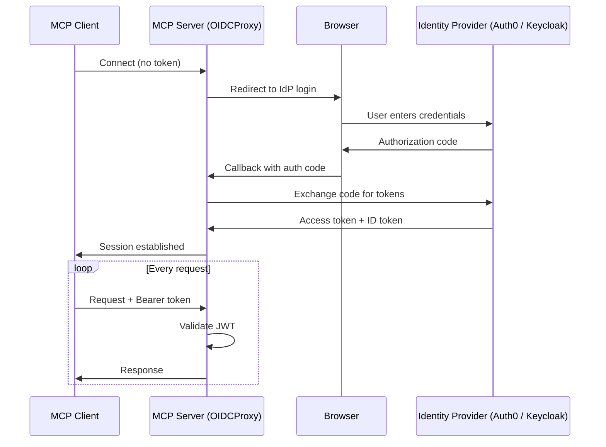
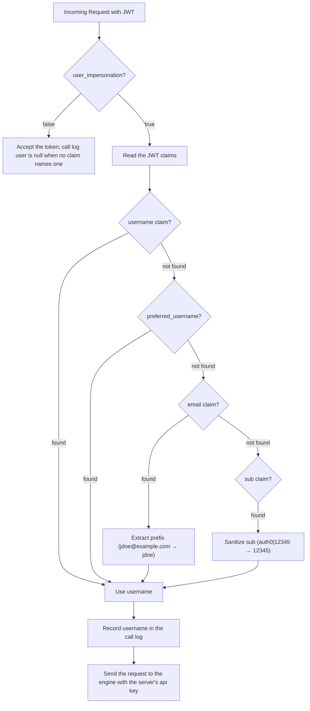

# Configuring OAuth 2.0 and OIDC Authentication

The Actian MCP Server supports OAuth 2.0 and OpenID Connect (OIDC) authentication. When you enable this feature, every client request must include a valid JSON Web Token (JWT) issued by a trusted identity provider (IdP).


!!! note "Deployment Considerations"
    - **Transport requirements**: OAuth only works with network transport such as `sse`, `http`, and `streamable-http`. You cannot use OAuth with the stdio transport, which is used for local IDE integrations like Claude Desktop or Cursor.


## Working with OAuth

The Actian MCP Server acts as an `OIDC Relying Party` by redirecting unauthenticated AI clients to the identity provider for secure login and token issuance. Once authenticated, the client includes this bearer token in all subsequent requests, allowing the server to validate the session and securely fulfill database queries.



## Configuring `oauth` Block

To enable authentication, add an `oauth` object to the `conf.json` file. The server reads the following data during startup:

| Field | Required | Description |
| :---- | :------- | :---------- |
| `FASTMCP_SERVER_AUTH_CONFIG_URL` | Yes | OIDC discovery URL, for example `https://domain/.well-known/openid-configuration`. Use `https://` in production |
| `FASTMCP_SERVER_AUTH_CLIENT_ID` | Yes | OAuth client ID provided by the identity provider |
| `FASTMCP_SERVER_AUTH_CLIENT_SECRET` | Yes | OAuth client secret |
| `FASTMCP_SERVER_AUTH_BASE_URL` | Yes | External URL of the MCP server, for example `https://<mcp-server-host>:8000`. It must use `https://`. |
| `FASTMCP_SERVER_AUTH_AUDIENCE` | Yes | Token audience |
| `user_impersonation` | No | Boolean. VectorAI DB has no per-user identity, so this only decides what a token must contain: with `true` (the default) a token must name a user, with `false` a service token without a user claim is accepted too. See [User Impersonation](#user-impersonation). |

### Example

```json
{
  "oauth": {
    "FASTMCP_SERVER_AUTH_CONFIG_URL": "https://dev-abc123.us.auth0.com/.well-known/openid-configuration",
    "FASTMCP_SERVER_AUTH_CLIENT_ID": "wNXUdrp9aBcDeFgHiJkLmN",
    "FASTMCP_SERVER_AUTH_CLIENT_SECRET": "a1B2c3D4e5F6g7H8i9J0kLmNoPqRsTuVwXyZ",
    "FASTMCP_SERVER_AUTH_BASE_URL": "https://<mcp-server-host>:8000",
    "FASTMCP_SERVER_AUTH_AUDIENCE": "<your-audience>",
    "user_impersonation": false
  }
}
```

!!! note "Configuration Considerations"
    You must either provide all four required OAuth fields (`CONFIG_URL`, `CLIENT_ID`, `CLIENT_SECRET`, and `BASE_URL`) or none. If you include `CONFIG_URL` and `CLIENT_ID`, and omit `CLIENT_SECRET` or `BASE_URL`, the server fails to start and throws a `KeyError`. To disable OAuth, remove the entire `oauth` block.

    These values come from your identity provider. Set up [Auth0](auth0.md) or [Keycloak](keycloak.md) first if you have not already, then come back to fill in these fields.

!!! info "Scopes"
    For read access you do not need to configure specific scopes. The server automatically requests the `openid`, `email`, and `profile` scopes.

    If you set `query_mode` to `read-write`, the server also requests the `mcp:write` scope, and a token without it cannot perform writes. You must define that scope in the identity provider first. See [Write support](../write-support.md) for how writes are authorized, and [Auth0](auth0.md) or [Keycloak](keycloak.md) for the setup steps.


## Resource-Server Mode

The flow above makes the MCP server run the login itself. When the calling application has already signed the user in with your identity provider, the server can instead verify the tokens that provider issued and never run a login of its own. This is resource-server mode: set `auth_mode` at the top level of `conf.json`, and an `oauth` block without a client ID or secret.

```json
{
  "auth_mode": "resource-server",
  "oauth": {
    "FASTMCP_SERVER_AUTH_CONFIG_URL": "https://<idp>/realms/<realm>/.well-known/openid-configuration",
    "FASTMCP_SERVER_AUTH_AUDIENCE": "<audience>",
    "FASTMCP_SERVER_AUTH_BASE_URL": "https://<mcp-server-host>:8000",
    "user_impersonation": false
  },
  "ssl_certfile": "/app/server.crt",
  "ssl_keyfile": "/app/server.key"
}
```

| Field | Required | Description |
| :---- | :------- | :---------- |
| `auth_mode` | Yes | `resource-server`. A top-level key, next to `host` and `port`. Without it, an `oauth` block with a client ID runs the login flow described above. |
| `FASTMCP_SERVER_AUTH_CONFIG_URL` | Yes | The identity provider's OIDC discovery document, as the **server** reaches it. The server reads `issuer` and `jwks_uri` from it; the issuer written into every token must match exactly. |
| `FASTMCP_SERVER_AUTH_AUDIENCE` | Yes | The audience every token must carry. There is no client ID to fall back to in this mode, so it is mandatory. See [Keycloak, Step 3: Add the Audience Mapper](keycloak.md#step-3-add-the-audience-mapper-required). |
| `FASTMCP_SERVER_AUTH_BASE_URL` | Yes | This server's address as the agents see it. Published in the protected-resource metadata; must start with `https://` unless `host` is `localhost`. |
| `user_impersonation` | No | Inside the `oauth` block. The engine sees only the server's api key, whoever the caller is. With the default `true` every token must name a user (`username`, `preferred_username` or `email` claim); with `false` a token without a user claim (a service or machine token) is accepted too. Either way the token's user name, when there is one, goes to the [call log](../index.md#call-log). A top-level key of this name is silently ignored. |

The server publishes its protected-resource metadata at `/.well-known/oauth-protected-resource/mcp`, naming the identity provider, and answers `401` to a request without a valid token. It never calls the provider's userinfo endpoint and never falls back to the `sub` claim for a user name.

Each request is checked for the token's signature, issuer, audience and expiry against the provider's published keys. A token that fails gets `401`; the server log says which check failed (`issuer mismatch`, `audience mismatch`).

### Scopes

A VectorAI DB server exposes one engine, so there are no per-target grants (`actian:...` scopes do not apply). Reads need a valid token for this server's audience; writes need the `mcp:write` scope on top, as in the login flow:

| Caller | Result |
|--------|--------|
| Valid token without `mcp:write` | reads work; every write tool answers `write operations require the 'mcp:write' scope, which the access token does not carry`, before any text is embedded and without an approval prompt |
| Valid token with `mcp:write` | writes go through the approval prompt as usual |
| No token, or a token that fails verification (signature, issuer, audience, expiry) | `401`; the `WWW-Authenticate` header points at the protected-resource metadata |

The server reads scopes from the `scope`, `scp` and `permissions` claims. Matching is exact. The identity provider issues `mcp:write`; the calling application asks its own provider for it. The setup steps are in [Auth0](auth0.md) and [Keycloak](keycloak.md).

## User Impersonation

!!! note "There is nothing to impersonate on VectorAI DB"
    The engine authenticates the server, not the person: every engine request carries the configured `vectorai.api_key_secret`, whoever the caller is. The OAuth token therefore protects the MCP Server, and `user_impersonation` only decides what a token must contain. Set it **inside** the `oauth` block; a top-level key is ignored.

|  user_impersonation | Server |
| :------------------- | :------- |
| `true` (default) | Verify the `JWT` and require a user claim (`username`, `preferred_username` or `email`); a token without one is refused with `401`. The user is recorded in the [call log](../index.md#call-log). |
| `false` | Verify the `JWT` and accept service or machine tokens that name no user as well. The caller's name, when the token carries one, is still recorded in the call log. |

In both settings reads need a valid token for this server's audience, and writes need the `mcp:write` scope on top, checked before any embedding call, then the approval prompt. An extension's own engine calls carry the key the extension sends, not the server's. See [Extensions](../extensions/index.md#execution-identity).


### Which name goes to the call log

When `user_impersonation` is `true`, the server takes the user name from the token in this order:



!!! tip "Provider-Specific Behavior"
    - **Auth0**: Does not return `username` or `preferred_username` by default. The server usually falls back to the email prefix, so the call log shows `jdoe` for `jdoe@example.com`.
    - **Keycloak**: Returns `preferred_username` by default when the `profile` scope is present; the call log shows the Keycloak login name.
    - **Either provider, when users sign in through an upstream connection**: Auth0 and Keycloak can both broker logins from Google, Microsoft Entra, SAML, or corporate single sign-on. In that case the `sub` claim carries a provider-specific ID such as `google-oauth2|12345`, and the call log shows `12345`. Map a usable `username` in the provider's user profile if you want readable names in the log. No database account is involved on VectorAI DB.  

## Secure Remote Deployments with HTTPS and TLS

OAuth 2.0 requires HTTPS. If you configure OAuth, the server mandates HTTPS and refuses to start unless you provide the `ssl_certfile` and `ssl_keyfile` paths.

### Step 1: Generate a Certificate

For remote testing, generate a self-signed certificate with a Subject Alternative Name (SAN). 

```bash
openssl req -x509 -newkey rsa:4096 -keyout server.key -out server.crt \
  -days 365 -nodes \
  -subj "/CN=<your-ip-or-hostname>" \
  -addext "subjectAltName=IP:<your-ip>"
chmod 600 server.key
```

!!! note "SAN is required"
    The `-addext "subjectAltName=IP:..."` flag is required. Node.js-based MCP clients (like VS Code and Cursor) strictly enforce SAN validation and reject certificates that only use the Common Name (CN) field.

!!! tip "Production certificates"
    For production environments, use a certificate issued by a trusted Certificate Authority (CA), such as Let's Encrypt or the corporate CA.

### Step 2: Configure TLS in `conf.json`

Add the `ssl_certfile` and `ssl_keyfile` fields to the top level of the `conf.json` file (outside the `oauth` block), and ensure `BASE_URL` uses `https://`:

```json
{
  "ssl_certfile": "/app/server.crt",
  "ssl_keyfile": "/app/server.key",
  "oauth": {
    "FASTMCP_SERVER_AUTH_BASE_URL": "https://<your-ip-or-hostname>:8000"
  }
}
```

The `ssl_certfile` and `ssl_keyfile` values are always the fixed **in-container** paths shown above, not the paths to the certificate files on the host. The server reads `ssl_certfile`/`ssl_keyfile` only from `conf.json` — there is no default and no way to supply them via the `docker run` command instead. What varies per deployment is where the certificate and key live on the host; that is set in [Step 3](#step-3-deploy-the-docker), which mounts them to these exact container paths.

The server validates that both paths exist at startup, and that `BASE_URL` uses `https://` when SSL is active.

### Step 3: Deploy the Docker

Mount the certificate and key into the container using volume flags:

!!! note "Example"
    The following example demonstrates how to deploy the VectorAI DB container with TLS.

```bash
docker run -p 8000:8000 \
  --add-host=host.docker.internal:host-gateway \
  -v /path/to/server.crt:/app/server.crt:ro \
  -v /path/to/server.key:/app/server.key:ro \
  -v /path/to/conf.json:/app/conf.json:ro \
  actian/vectorai-mcp-server:1.2.0
```

Reference the container paths in `conf.json`:
```json
{
  "ssl_certfile": "/app/server.crt",
  "ssl_keyfile": "/app/server.key"
}
```

!!! note "Docker Key Permissions"
    If mounting the key as a volume, the container user must be able to read it:

    - **Best practice**: set the permissions of `server.key` and `conf.json` to 600.


### Step 4: Trust the Certificate in the MCP Client

By default, Node.js-based MCP clients (VS Code and Cursor) reject self-signed certificates. You must explicitly trust the certificate on your development machine.

1. Securely copy the certificate to your machine:

     ```bash
       scp user@<your-vm>:/path/to/server.crt ~/server.crt
     ```

2. Configure the operating system:

=== "macOS"

    ```bash
    # Add to system keychain
    sudo security add-trusted-cert -d -r trustRoot \
      -k /Library/Keychains/System.keychain ~/server.crt

    # Ensure VS Code's Node.js runtime picks it up
    launchctl setenv NODE_EXTRA_CA_CERTS "$HOME/server.crt"

    # Fully restart VS Code (Cmd+Q, then reopen)
    ```

    !!! tip "Persist across reboots"
        Add `export NODE_EXTRA_CA_CERTS="$HOME/server.crt"` to `~/.zprofile`.

    !!! tip "Remove the certificate"
        Run `sudo security delete-certificate -c "<CN>" /Library/Keychains/System.keychain`

=== "Linux"

    ```bash
    sudo cp ~/server.crt /usr/local/share/ca-certificates/mcp-server.crt
    sudo update-ca-certificates

    # For VS Code / Node.js:
    export NODE_EXTRA_CA_CERTS="$HOME/server.crt"
    # Add to ~/.bashrc or ~/.profile to persist across sessions
    ```

=== "Windows"

    ```powershell
    # Import into Trusted Root store (run PowerShell as Administrator)
    Import-Certificate -FilePath "$env:USERPROFILE\server.crt" `
      -CertStoreLocation Cert:\LocalMachine\Root

    # For VS Code / Node.js:
    [System.Environment]::SetEnvironmentVariable(
      "NODE_EXTRA_CA_CERTS",
      "$env:USERPROFILE\server.crt",
      "User"
    )

    # Fully restart VS Code after setting the variable
    ```

## Security Best Practices

!!! danger "Protect your secrets"
    The `conf.json` file contains `CLIENT_SECRET` in plaintext. The following are the security guidelines:
    
    - **Lock down file permissions**: run `chmod 600 conf.json` on the host.

    - **Mandate HTTPS**: Always use `https://` for the `BASE_URL`. Tokens sent over plain HTTP are vulnerable to interception.


## Provider Setup Guides

Choose your identity provider for step-by-step setup instructions:

<div class="grid cards" markdown>

- :material-cloud: **[Auth0](auth0.md)**  
  Cloud-hosted identity provider. Ideal for teams that want a managed service with no infrastructure to maintain.

- :material-key: **[Keycloak](keycloak.md)**  
  Open-source, self-hosted identity provider. Ideal for teams that need full control over their authentication infrastructure.

</div>
