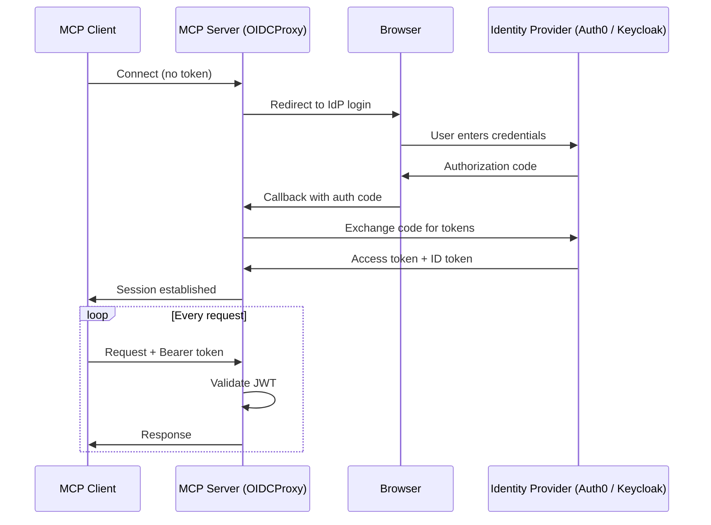
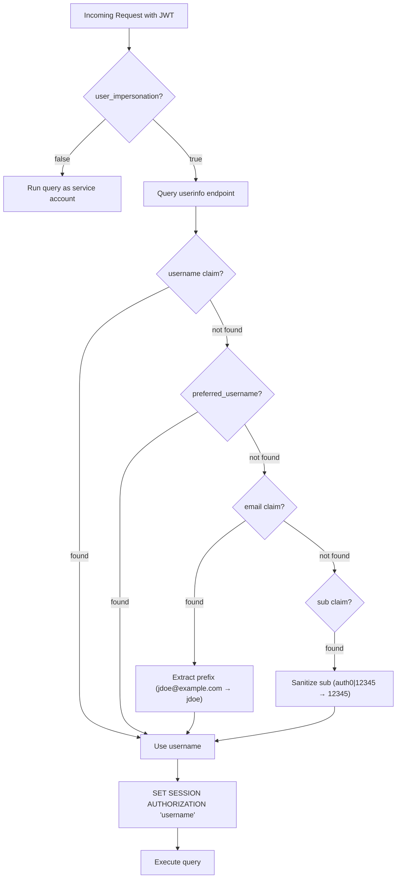

# Configuring OAuth 2.0 and OIDC Authentication

The Actian MCP Server supports OAuth 2.0 and OpenID Connect (OIDC) authentication. When you enable this feature, every client request must include a valid JSON Web Token (JWT) issued by a trusted identity provider (IdP).


!!! note "Deployment Considerations"
    - **Transport requirements**: OAuth only works with network transport such as `sse`, `http`, and `streamable-http`. You cannot use OAuth with the stdio transport, which is used for local IDE integrations like Claude Desktop or Cursor.


## Working with OAuth

The Actian MCP Server acts as an `OIDC Relying Party` by redirecting unauthenticated AI clients to the identity provider for secure login and token issuance. Once authenticated, the client includes this bearer token in all subsequent requests, allowing the server to validate the session and securely fulfill database queries.



## Configuring `oauth` Block

To enable authentication, add an `oauth` object to the `conf.json` file. The server reads the following data during startup:

| Field | Required | Description |
| :---- | :------- | :---------- |
| `FASTMCP_SERVER_AUTH_CONFIG_URL` | Yes | OIDC discovery URL, for example `https://domain/.well-known/openid-configuration`. Use `https://` in production |
| `FASTMCP_SERVER_AUTH_CLIENT_ID` | Yes | OAuth client ID provided by the identity provider |
| `FASTMCP_SERVER_AUTH_CLIENT_SECRET` | Yes | OAuth client secret |
| `FASTMCP_SERVER_AUTH_BASE_URL` | Yes | External URL of the MCP server, for example `https://<mcp-server-host>:8000`. It must use `https://`. |
| `FASTMCP_SERVER_AUTH_AUDIENCE` | Yes | Token audience |
| `user_impersonation` | No | Boolean. If `true` (the default setting), the server runs each query as the authenticated user using `SET SESSION AUTHORIZATION`. |

### Example

```json
{
  "oauth": {
    "FASTMCP_SERVER_AUTH_CONFIG_URL": "https://dev-abc123.us.auth0.com/.well-known/openid-configuration",
    "FASTMCP_SERVER_AUTH_CLIENT_ID": "wNXUdrp9aBcDeFgHiJkLmN",
    "FASTMCP_SERVER_AUTH_CLIENT_SECRET": "a1B2c3D4e5F6g7H8i9J0kLmNoPqRsTuVwXyZ",
    "FASTMCP_SERVER_AUTH_BASE_URL": "https://<mcp-server-host>:8000",
    "FASTMCP_SERVER_AUTH_AUDIENCE": "<your-audience>",
    "user_impersonation": false
  }
}
```

!!! note "Configuration Considerations"
    You must either provide all four required OAuth fields (`CONFIG_URL`, `CLIENT_ID`, `CLIENT_SECRET`, and `BASE_URL`) or none. If you include `CONFIG_URL` and `CLIENT_ID`, and omit `CLIENT_SECRET` or `BASE_URL`, the server fails to start and throws a `KeyError`. To disable OAuth, remove the entire `oauth` block.

    These values come from your identity provider. Set up [Auth0](auth0.md) or [Keycloak](keycloak.md) first if you have not already, then come back to fill in these fields.

!!! info "Scopes"
    For read access you do not need to configure specific scopes. The server automatically requests the `openid`, `email`, and `profile` scopes.

    If you set `query_mode` to `read-write`, the server also requests the `mcp:write` scope, and a token without it cannot perform writes. You must define that scope in the identity provider first. See [Write support](../write-support.md) for how writes are authorized, and [Auth0](auth0.md) or [Keycloak](keycloak.md) for the setup steps.


## Resource-Server Mode

The flow above makes the MCP server run the login itself. When the calling application has already signed the user in with your identity provider, the server can instead verify the tokens that provider issued and never run a login of its own. This is resource-server mode: set `auth_mode` at the top level of `conf.json`, and an `oauth` block without a client ID or secret.

```json
{
  "auth_mode": "resource-server",
  "oauth": {
    "FASTMCP_SERVER_AUTH_CONFIG_URL": "https://<idp>/realms/<realm>/.well-known/openid-configuration",
    "FASTMCP_SERVER_AUTH_AUDIENCE": "<audience>",
    "FASTMCP_SERVER_AUTH_BASE_URL": "https://<mcp-server-host>:8000",
    "user_impersonation": false
  },
  "ssl_certfile": "/app/server.crt",
  "ssl_keyfile": "/app/server.key"
}
```

| Field | Required | Description |
| :---- | :------- | :---------- |
| `auth_mode` | Yes | `resource-server`. A top-level key, next to `host` and `port`. Without it, an `oauth` block with a client ID runs the login flow described above. |
| `FASTMCP_SERVER_AUTH_CONFIG_URL` | Yes | The identity provider's OIDC discovery document, as the **server** reaches it. The server reads `issuer` and `jwks_uri` from it; the issuer written into every token must match exactly. |
| `FASTMCP_SERVER_AUTH_AUDIENCE` | Yes | The audience every token must carry. There is no client ID to fall back to in this mode, so it is mandatory. See [Keycloak, Step 3: Add the Audience Mapper](keycloak.md#step-3-add-the-audience-mapper-required). |
| `FASTMCP_SERVER_AUTH_BASE_URL` | Yes | This server's address as the agents see it. Published in the protected-resource metadata; must start with `https://` unless `host` is `localhost`. |
| `user_impersonation` | Yes, for Zen | Must be `false`, **inside** the `oauth` block. Zen cannot switch the database user per request; every URL connects as the login in its configuration. With `false`, a token without a user claim (a service or machine token) is accepted and the token's user name, when there is one, goes to the [call log](../index.md#call-log). A top-level key of this name is silently ignored and the default `true` stays in effect, which refuses every token without a user claim. |

The server publishes its protected-resource metadata at `/.well-known/oauth-protected-resource/mcp`, naming the identity provider, and answers `401` to a request without a valid token. It never calls the provider's userinfo endpoint and never falls back to the `sub` claim for a user name.

Each request is checked for the token's signature, issuer, audience and expiry against the provider's published keys. A token that fails gets `401`; the server log says which check failed (`issuer mismatch`, `audience mismatch`).

### Per-Target Scopes

On a single-database server, writes need the `mcp:write` scope as in the login flow. On a server that [serves several databases](../multi-target.md), each URL is guarded by its own grants inside the token:

```text
actian:{host}:{instance}:{database}:read
actian:{host}:{instance}:{database}:write
```

The three middle parts are those of the target entry, so an entry `{"host": "zen16", "instance": "admin", "databases": ["DEMODATA"]}` is read with `actian:zen16:admin:DEMODATA:read` and written with `actian:zen16:admin:DEMODATA:write`. The server reads grants from the `scope`, `scp` and `permissions` claims. Matching is exact.

| Caller | Result |
|--------|--------|
| Token with the `read` grant for the URL | reads work; a write is refused before anything reaches Zen: `no scope grants 'write'` |
| Token with the `write` grant | writes go through the approval prompt as usual; on a [read-only persona](../multi-target.md#read-only-personas) the engine refuses them regardless of the grant |
| Token without a grant for the URL | `404`, the same answer as for a URL that does not exist, on purpose |
| No token, or a token that fails verification | `401` |

`list_accessible_targets` returns only the URLs the token grants, see [Tools](../tools/index.md#list_accessible_targets).

!!! warning "`allow_unscoped_reads` is for test setups"
    `"allow_unscoped_reads": true` lets any valid token read every target in the registry, and the server logs a warning at every start while it is set. It exists to stand up routing before the identity provider has the scopes; never use it for a deployment with real credentials behind it. Writes still need the `write` grant.

!!! note "Where the scopes come from"
    Your identity provider must issue the grants. In Keycloak, create client scopes with a hardcoded-claim mapper that writes the `actian:...` values into a claim such as `scp`, and assign them to the calling client; in Auth0, define them as permissions on the API and grant them through a role, which puts them into the `permissions` claim. The MCP server does not advertise or request them: the calling application asks its own provider for them.

## User Impersonation

!!! warning "Not supported on Zen"
    Zen does not support `SET SESSION AUTHORIZATION`, so user impersonation is unavailable. Set `user_impersonation` to `false` **inside** the `oauth` block; a top-level key is ignored. JWT authentication still works; only per-user database switching is skipped. The rest of this section describes the impersonation behavior that does not apply to Zen.

By default, the `user_impersonation` field is set to `true`. The server extracts a username from the authenticated user's JWT and runs `SET SESSION AUTHORIZATION "<username>"` before executing a database query. This ensures users only interact with data their specific database account is permitted to see.

Impersonation covers extension-authored tools as well as the built-in ones, so an extension is also bounded by the end user's database privileges. See [Extensions](../extensions/index.md#execution-identity).

|  user_impersonation | Server |
| :------------------- | :------- |
| `true` (default) | Verify the `JWT` and run `SET SESSION AUTHORIZATION "<user>"` for each query. Every OAuth user needs a matching database account. |
| `false` | Verify the `JWT` and reject unauthenticated requests. However, all approved queries will run under the shared service-account connection pool credentials. The caller's name, when the token carries one, is still recorded in the [call log](../index.md#call-log). |


### Extracting Username

When user impersonation is active, the server extracts the database username from the token using the following priority order:



!!! tip "Provider-Specific Behavior"
    - **Auth0**: Does not return `username` or `preferred_username` by default. The server usually falls back to the email prefix. Ensure that the database usernames match the email prefixes, for example, create database user `jdoe` for `jdoe@example.com`.
    - **Keycloak**: Returns `preferred_username` by default when the `profile` scope is present. Create database users that match the Keycloak login names.
    - **Either provider, when users sign in through an upstream connection**: Auth0 and Keycloak can both broker logins from Google, Microsoft Entra, SAML, or corporate single sign-on. In that case the `sub` claim carries a provider-specific ID such as `google-oauth2|12345`. The server strips the prefix and is left with `12345`, which is unlikely to match a database account. Map a usable `username` in the provider's user profile, or set `user_impersonation` to `false`.  

## Secure Remote Deployments with HTTPS and TLS

OAuth 2.0 requires HTTPS. If you configure OAuth, the server mandates HTTPS and refuses to start unless you provide the `ssl_certfile` and `ssl_keyfile` paths.

### Step 1: Generate a Certificate

For remote testing, generate a self-signed certificate with a Subject Alternative Name (SAN). 

```bash
openssl req -x509 -newkey rsa:4096 -keyout server.key -out server.crt \
  -days 365 -nodes \
  -subj "/CN=<your-ip-or-hostname>" \
  -addext "subjectAltName=IP:<your-ip>"
chmod 600 server.key
```

!!! note "SAN is required"
    The `-addext "subjectAltName=IP:..."` flag is required. Node.js-based MCP clients (like VS Code and Cursor) strictly enforce SAN validation and reject certificates that only use the Common Name (CN) field.

!!! tip "Production certificates"
    For production environments, use a certificate issued by a trusted Certificate Authority (CA), such as Let's Encrypt or the corporate CA.

### Step 2: Configure TLS in `conf.json`

Add the `ssl_certfile` and `ssl_keyfile` fields to the top level of the `conf.json` file (outside the `oauth` block), and ensure `BASE_URL` uses `https://`:

```json
{
  "ssl_certfile": "/app/server.crt",
  "ssl_keyfile": "/app/server.key",
  "oauth": {
    "FASTMCP_SERVER_AUTH_BASE_URL": "https://<your-ip-or-hostname>:8000"
  }
}
```

The `ssl_certfile` and `ssl_keyfile` values are always the fixed **in-container** paths shown above, not the paths to the certificate files on the host. The server reads `ssl_certfile`/`ssl_keyfile` only from `conf.json` — there is no default and no way to supply them via the `docker run` command instead. What varies per deployment is where the certificate and key live on the host; that is set in [Step 3](#step-3-deploy-the-docker), which mounts them to these exact container paths.

The server validates that both paths exist at startup, and that `BASE_URL` uses `https://` when SSL is active.

### Step 3: Deploy the Docker

Mount the certificate and key into the container using volume flags:

!!! note "Example"
    The following example demonstrates how to deploy the Zen docker.

```bash
docker run -p 8000:8000 \
  -v /path/to/server.crt:/app/server.crt:ro \
  -v /path/to/server.key:/app/server.key:ro \
  -v /path/to/conf.json:/app/conf.json:ro \
  actian/zen-mcp-server:1.1.0
```

Reference the container paths in `conf.json`:
```json
{
  "ssl_certfile": "/app/server.crt",
  "ssl_keyfile": "/app/server.key"
}
```

!!! note "Docker Key Permissions"
    If mounting the key as a volume, the container user must be able to read it:

    - **Best practice**: `Ensure that server.key and conf.json file permissions are set to 600.


### Step 4: Trust the Certificate in the MCP Client

By default, Node.js-based MCP clients (VS Code and Cursor) reject self-signed certificates. You must explicitly trust the certificate on your development machine.

1. Securely copy the certificate to your machine:

     ```bash
       scp user@<your-vm>:/path/to/server.crt ~/server.crt
     ```

2. Configure the operating system:

=== "macOS"

    ```bash
    # Add to system keychain
    sudo security add-trusted-cert -d -r trustRoot \
      -k /Library/Keychains/System.keychain ~/server.crt

    # Ensure VS Code's Node.js runtime picks it up
    launchctl setenv NODE_EXTRA_CA_CERTS "$HOME/server.crt"

    # Fully restart VS Code (Cmd+Q, then reopen)
    ```

    !!! tip "Persist across reboots"
        Add `export NODE_EXTRA_CA_CERTS="$HOME/server.crt"` to `~/.zprofile`.

    !!! tip "Remove the certificate"
        Run `sudo security delete-certificate -c "<CN>" /Library/Keychains/System.keychain`

=== "Linux"

    ```bash
    sudo cp ~/server.crt /usr/local/share/ca-certificates/mcp-server.crt
    sudo update-ca-certificates

    # For VS Code / Node.js:
    export NODE_EXTRA_CA_CERTS="$HOME/server.crt"
    # Add to ~/.bashrc or ~/.profile to persist across sessions
    ```

=== "Windows"

    ```powershell
    # Import into Trusted Root store (run PowerShell as Administrator)
    Import-Certificate -FilePath "$env:USERPROFILE\server.crt" `
      -CertStoreLocation Cert:\LocalMachine\Root

    # For VS Code / Node.js:
    [System.Environment]::SetEnvironmentVariable(
      "NODE_EXTRA_CA_CERTS",
      "$env:USERPROFILE\server.crt",
      "User"
    )

    # Fully restart VS Code after setting the variable
    ```

## Security Best Practices

!!! danger "Protect your secrets"
    The `conf.json` file contains `CLIENT_SECRET` in plaintext. The following are the security guidelines:
    
    - **Lock down file permissions**: Run chmod 600 conf.json` to restrict access on the host machine.

    - **Mandate HTTPS**: Always use `https://` for the `BASE_URL`. Tokens sent over plain HTTP are vulnerable to interception.


## Provider Setup Guides

Choose your identity provider for step-by-step setup instructions:

<div class="grid cards" markdown>

- :material-cloud: **[Auth0](auth0.md)**  
  Cloud-hosted identity provider. Ideal for teams that want a managed service with no infrastructure to maintain.

- :material-key: **[Keycloak](keycloak.md)**  
  Open-source, self-hosted identity provider. Ideal for teams that need full control over their authentication infrastructure.

</div>
